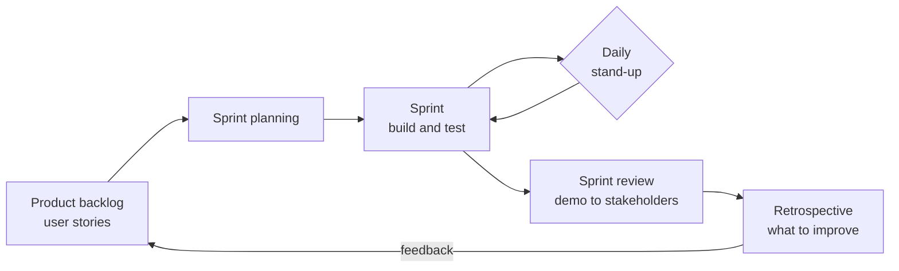

# Agile Scrum Project: Software Development Lifecycle (CS 250)

A sprint review and retrospective from the **SNHU Travel** project, where I worked through each Scrum role (Product Owner, Scrum Master, Developer, and Tester) to deliver features in short, iterative sprints.

Built for **CS 250: Software Development Lifecycle** at Southern New Hampshire University.

---

## The Scrum Process

## Roles I Worked Through

| Role | Responsibility |
|---|---|
| **Product Owner** | Sets direction, writes and prioritizes user stories |
| **Scrum Master** | Keeps the team focused and removes obstacles |
| **Developer** | Builds the features described in the user stories |
| **Tester** | Writes test cases from acceptance criteria and protects quality |

## Repository Contents

| File | Description |
|---|---|
| [Sprint-Review-and-Retrospective.docx](Sprint-Review-and-Retrospective.docx) | Sprint review and retrospective for the SNHU Travel project |

## Skills Demonstrated

Agile and Scrum · user stories and acceptance criteria · sprint planning and retrospectives · cross-role collaboration

---

## Reflection

### How do I interpret user needs and implement them into a program? How does creating user stories help with this?

I learned that understanding what a user needs should come before deciding how to build a feature. User stories helped me take a customer request and turn it into something the development team could understand and work on. Writing a story from the user's point of view also helped me focus on why a feature was needed instead of only thinking about the technical work. Acceptance criteria made the expectations clearer and gave the developer and tester something specific to work toward. If something was unclear, communicating with the Product Owner or stakeholder was important before moving forward.

### How do I approach developing programs? What Agile processes do I hope to incorporate into my future development work?

My approach to developing programs has changed during this course. I used to think mostly about writing the code and getting the program to work. Now I see development as a process that includes planning, communication, testing, feedback, and improvement. In future projects, I would like to use short development cycles, user stories, Sprint Planning, regular communication, testing throughout development, and retrospectives. I especially like the idea of getting feedback while a product is being developed instead of waiting until everything is finished. This makes it easier to catch problems and adjust when requirements change.

### What does it mean to be a good team member in software development?

To me, being a good team member means doing your part while also understanding that software development depends on collaboration. A developer should be willing to communicate when something is unclear, listen to feedback, and help solve problems instead of working completely independently. During the SNHU Travel project, working through the different Scrum roles helped me see how much each role depends on the others. The Product Owner provides direction, developers build the product, testers help protect quality, and the Scrum Master helps the team stay focused and work through obstacles. A strong team member communicates clearly, respects the responsibilities of others, and stays focused on the team's overall goal.
